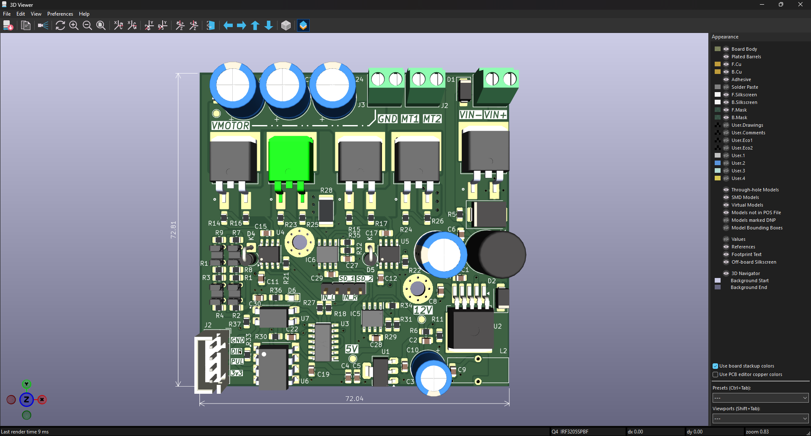
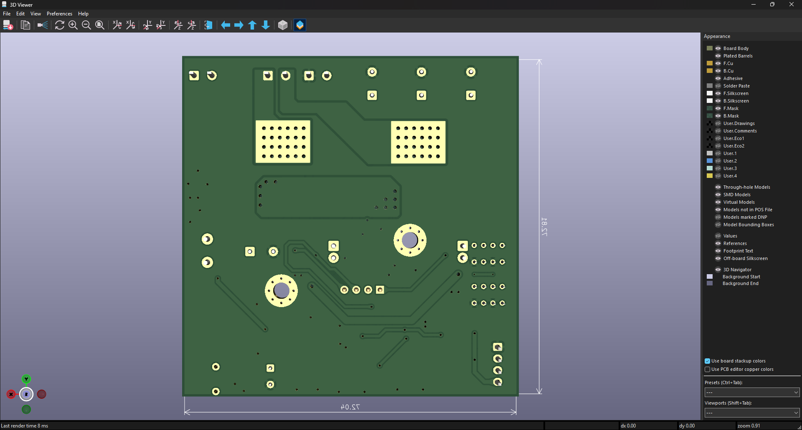

# HBridge_1Motor

Bo mạch điều khiển động cơ sử dụng cầu H, được thiết kế bằng KiCad. Thư mục dự án gồm sơ đồ nguyên lý, PCB và hình ảnh mô hình 3D để tham khảo khi đọc thiết kế và lắp ráp.

> **Lưu ý:** Các thông số như điện áp làm việc, dòng tối đa, tần số PWM và giới hạn nhiệt chưa được ghi rõ trong tài liệu hiện có. Hãy kiểm tra sơ đồ, datasheet và tính toán nhiệt trước khi cấp nguồn hoặc kết nối động cơ.

## Hình ảnh PCB

**Mặt trên**



**Mặt dưới**



Kích thước board hiển thị trong mô hình 3D xấp xỉ 72 x 73 mm.

## Tổng quan thiết kế

Mạch gồm các khối chính sau:

| Khối | Thành phần / chức năng |
| --- | --- |
| Công suất động cơ | MOSFET IRF3205, driver gate IR2104 và điện trở shunt R28 (0.02 ohm, 5 W). |
| Nguồn | Đầu vào được đánh dấu VIN+ / VIN-; mạch có các đường nguồn +12 V, +5 V và +3.3 V. Sơ đồ sử dụng XL4015 và AMS1117-5.0. |
| Điều khiển | PCB có các nhãn DIR và PUL; schematic có các net PWM, DIR, IN_L, IN_R và DIR_MCU. Hãy đối chiếu sơ đồ để xác nhận ánh xạ chân trước khi kết nối bộ điều khiển. |
| Cách ly tín hiệu | Schematic có các linh kiện 6N137 và PC817. |
| Cảm biến và xử lý tín hiệu | Các cảm biến quang GP1S093HCZ0F, cùng LM393 và MCP6002. |
| Bảo vệ / hiển thị | Schematic có TVS SMAJ28A, các diode và LED. |

Bảng trên tóm tắt các linh kiện nhận diện được từ schematic, không thay thế cho việc truy mạch và kiểm tra datasheet.

## Đầu nối trên PCB

| Nhãn trên PCB | Ý nghĩa theo silkscreen |
| --- | --- |
| VIN+ / VIN- | Đầu vào nguồn. |
| GND / DIR / PUL / 3V3 | Header tín hiệu điều khiển và mass. Đối chiếu schematic để xác nhận từng chân. |
| GND / MT1 / MT2 | Đầu nối tải theo nhãn trên PCB. |

Hãy đối chiếu hướng chân và net trong schematic trước khi đấu dây; không suy diễn cực tính hoặc chức năng chân chỉ từ vị trí đầu nối.


## Cấu trúc thư mục

```text
HBridge_1Motor/
|-- 01Docs/
|   |-- IMG/                 # Hình mô hình 3D PCB
|   `-- LIB/                 # Thư viện 3D, footprint và symbol
|-- 02Schematic/
|   `-- schematic.pdf        # Sơ đồ nguyên lý xuất PDF
|-- 03PCBLayout/
|   |-- HBridge_1Motor.kicad_pro
|   |-- HBridge_1Motor.kicad_sch
|   |-- HBridge_1Motor.kicad_pcb
|   `-- fp-lib-table
|-- 04Manufacturing/
|   |-- bom/ibom.html        # BOM tương tác
|   `-- gerber_to_order/     # Gói Gerber/Excellon theo nhà sản xuất
`-- readme.md
```

- [Sơ đồ nguyên lý dạng PDF](02Schematic/schematic.pdf) — tiện xem nhanh hoặc chia sẻ mà không cần mở KiCad.
- [BOM tương tác](04Manufacturing/bom/ibom.html) — mở bằng trình duyệt để tra cứu linh kiện trên PCB.

