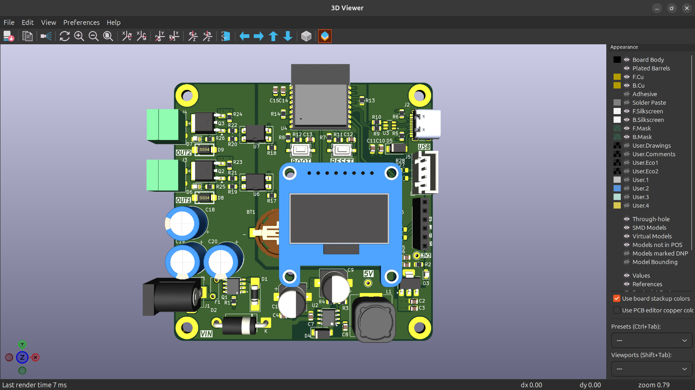

# Pump Timer 12V

Thiết kế bộ điều khiển bơm theo lịch, gồm bo mạch KiCad và firmware ESP-IDF.
Firmware hỗ trợ điều khiển hai ngõ ra bơm, cấu hình qua website và hiển thị
trạng thái trên màn hình TFT.


## Tính năng chính

- Lập lịch và điều khiển thủ công hai ngõ ra bơm qua website.
- Hiển thị trạng thái, thời gian và thông tin Wi-Fi trên TFT ST7735.
- Dùng RTC DS3231 để giữ giờ; đồng bộ thời gian qua NTP khi có mạng.
- Có sơ đồ nguyên lý, thiết kế PCB, BOM và gói Gerber để tham khảo sản xuất.

## Hình ảnh bo mạch



## Bắt đầu

- **Xem sơ đồ:** mở [sơ đồ nguyên lý dạng PDF](02Schematic/schematics.pdf).
- **Xem BOM:** mở [BOM tương tác](04Manufacturing/bom/ibom.html) bằng trình duyệt.
- **Chỉnh sửa PCB:** mở project KiCad
  [`RTC_PUMP12V5A_V2.kicad_pro`](03PCBLayout/RTC_PUMP12V5A_V2.kicad_pro).
- **Build firmware:** cài ESP-IDF 5.5 và toolchain ESP32-C3, sau đó chạy từ thư
  mục `PUMPTIMER `:

  ```bash
  cd 05Firmware/PumpTimer12V
  idf.py set-target esp32c3
  idf.py menuconfig
  idf.py build
  ```

  Cấu hình Wi-Fi, thông tin đăng nhập website, chân GPIO và mức kích relay
  trong `menuconfig` theo phần cứng thực tế. Hướng dẫn chi tiết nằm trong
  [README firmware](05Firmware/PumpTimer12V/README.md).

## Cấu trúc thư mục

| Thư mục | Nội dung |
| --- | --- |
| `01Docs/` | Hình ảnh bo mạch |
| `02Schematic/` | Sơ đồ nguyên lý PDF |
| `03PCBLayout/` | Project KiCad, schematic, PCB và thư viện |
| `04Manufacturing/` | BOM tương tác và gói Gerber |
| `05Firmware/PumpTimer12V/` | Firmware ESP-IDF cho ESP32-C3 |

## Trước khi sử dụng hoặc sản xuất

- Xác nhận sơ đồ, pinout, điện áp, dòng tải và mức kích của relay với phần cứng
  đang dùng; không mặc định tên project là thông số định mức đã kiểm chứng.
- Kiểm tra ERC/DRC và đối chiếu các file Gerber với thiết kế hiện tại trước khi
  đặt PCB.
- Thử nghiệm có kiểm soát với tải phù hợp; không kết nối tải điện lưới khi thử
  firmware trên 

