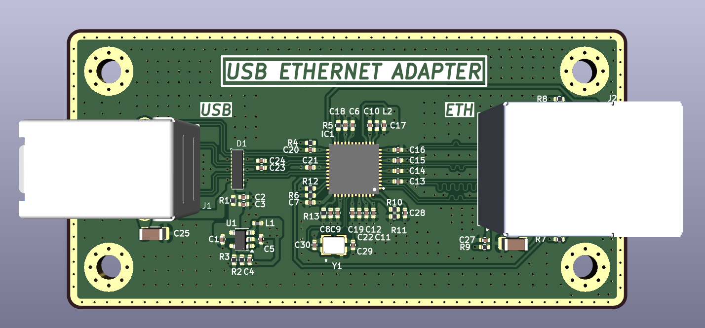
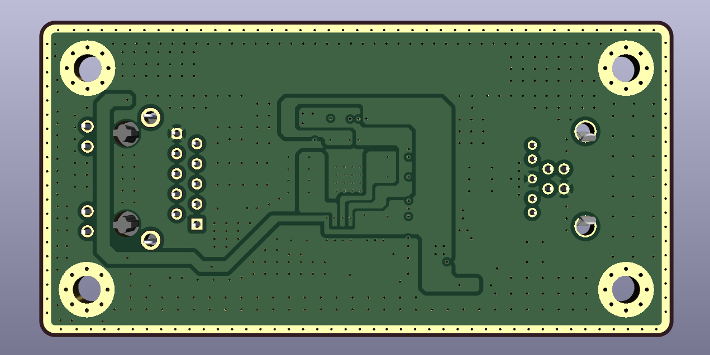
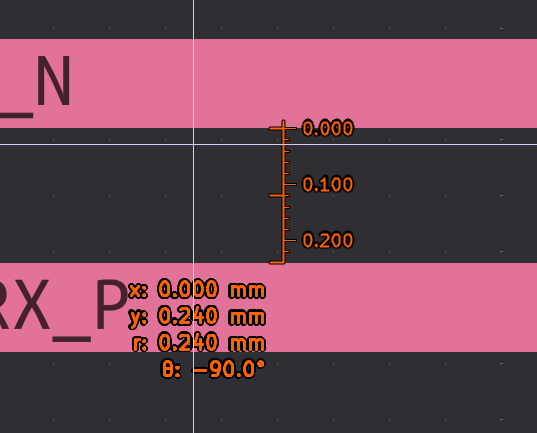
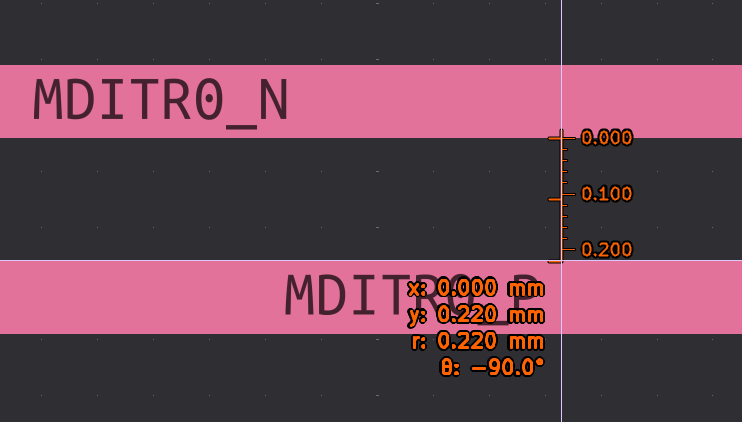
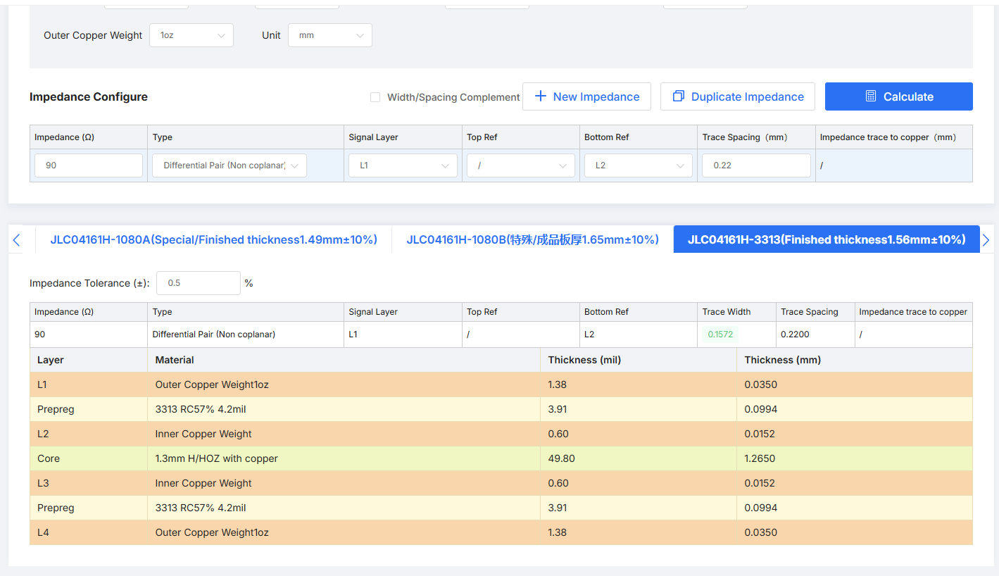
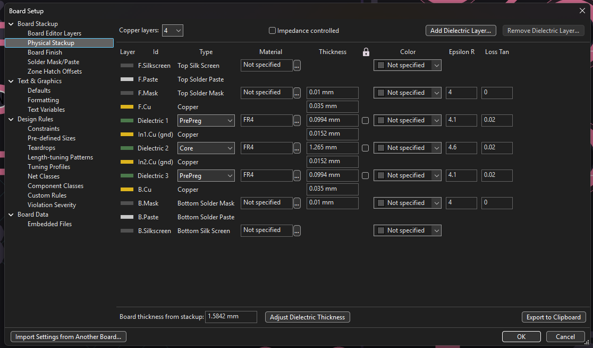
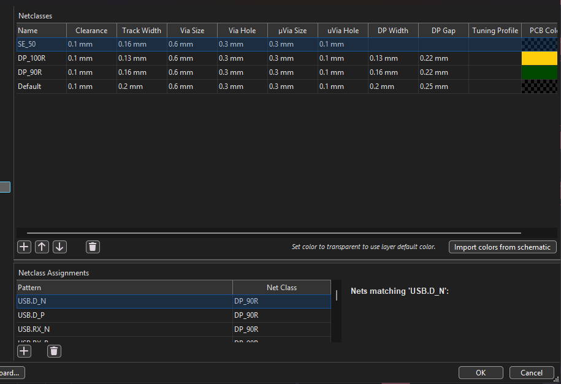

# Bộ chuyển đổi USB sang Ethernet

Dự án thiết kế một bo mạch chuyển đổi **USB 3.0 sang Ethernet Gigabit**, được vẽ bằng KiCad. Bo mạch dùng chip **Microchip LAN7800/Y9X** để nối USB với mạng Ethernet, có cổng USB Type-B ở một đầu và cổng RJ45 ở đầu còn lại.

## Hình ảnh bo mạch

| Mặt trước | Mặt sau |
| --- | --- |
|  |  |

## Thiết kế gồm những gì?

- **USB:** cổng USB 3.0 Type-B.
- **Ethernet:** LAN7800/Y9X hỗ trợ giao tiếp 10/100/1000 Mbps, kết nối với jack RJ45 tích hợp biến áp HR911130A.
- **Mạch phụ trợ:** thạch anh 25 MHz và LED báo trạng thái mạng.
- **PCB:** thiết kế 4 lớp; tài liệu có thông tin stackup và thiết lập trở kháng cho các đường tín hiệu vi sai.

## Trở kháng cặp vi sai

Các đường tín hiệu tốc độ cao được thiết kế theo trở kháng vi sai đặc trưng của giao tiếp:

- **90 Ω cho USB 3.0 SuperSpeed:** áp dụng cho các cặp phát/thu `SSTX` và `SSRX`.
- **100 Ω cho Ethernet:** áp dụng cho các cặp tín hiệu mạng nối giữa LAN7800 và biến áp trong jack HR911130A.

Ảnh dưới đây ghi lại khoảng cách giữa các đường mạch vi sai trên layout PCB:

### Cặp 90 Ω

### Cặp 100 Ω

Với stackup JLCPCB **JLC0416IH-3313** trong ảnh, calculator cho kết quả cặp 90 Ω không coplanar trên lớp L1, tham chiếu lớp L2: trace rộng **0,1572 mm**, gap **0,22 mm**.

Các kích thước này phụ thuộc vào stackup thực tế, độ dày đồng và lớp tham chiếu. Khi đổi stackup hoặc nhà sản xuất, hãy nhập lại cấu hình vào calculator và xác nhận khả năng kiểm soát trở kháng với nhà sản xuất; không dùng lại width/gap như thông số cố định.

### Thiết lập trong KiCad

**Physical Stackup:** project khai báo PCB 4 lớp đồng với vật liệu FR4 và độ dày tổng khoảng 1,584 mm.

**Net Classes:** project có các class `DP_90R` và `DP_100R`. Ảnh thiết lập thể hiện width lần lượt là 0,16 mm và 0,13 mm, cùng gap 0,22 mm. Đây là thông số luật thiết kế trong KiCad; cần đối chiếu với calculator theo stackup thực tế trước khi sản xuất.

## Cấu trúc dự án

| Thư mục | Nội dung |
| --- | --- |
| `01Docs/IMG/` | Hình ảnh bo mạch và tài liệu tham khảo về stackup, net class, trở kháng |
| `01Docs/LIB/3D/` | Model 3D của linh kiện |
| `01Docs/LIB/Footprints/` | Footprint KiCad |
| `01Docs/LIB/Symbols/` | Symbol KiCad |
| `02Schematic/` | Bản PDF schematic và các lớp PCB đã xuất để xem nhanh |
| `03PCBLayout/` | Project KiCad, schematic và PCB có thể chỉnh sửa |
| `04Manufacturing/ibom/` | BOM tương tác, hỗ trợ tra linh kiện và vị trí lắp trên PCB |
| `04Manufacturing/gerber_to_order/` | Các gói Gerber đóng gói theo định dạng đặt PCB của nhiều nhà sản xuất |
| `05FimwareTest/` | Khu vực dành cho firmware và kiểm thử; hiện chưa có file |

## Bắt đầu xem dự án

- **Xem sơ đồ mạch:** mở [`schematic.pdf`](02Schematic/schematic.pdf).
- **Xem các lớp PCB:** mở `top_layer.pdf`, `layer2.pdf`, `layer3.pdf` hoặc `bottom_layer.pdf` trong `02Schematic/`.
- **Chỉnh sửa thiết kế:** cài KiCad và mở project [`USB_Ethernet_Adapter.kicad_pro`](03PCBLayout/USB_Ethernet_Adapter.kicad_pro).
- **Tra cứu linh kiện:** mở [BOM tương tác](04Manufacturing/ibom/ibom.html) bằng trình duyệt.
- **Đặt chế tạo PCB:** chọn gói ZIP tương ứng với nhà sản xuất trong `04Manufacturing/gerber_to_order/`.

## Trạng thái

Repository hiện có thiết kế KiCad, tài liệu PDF, BOM tương tác và các gói Gerber để gửi nhà sản xuất. Các gói Gerber là dữ liệu xuất từ thiết kế, không đồng nghĩa bo mạch đã được chế tạo hoặc kiểm thử. Thư mục firmware/kiểm thử hiện chưa có nội dung; cần kiểm tra ERC/DRC và đối chiếu yêu cầu của nhà sản xuất trước khi đặt hàng.
